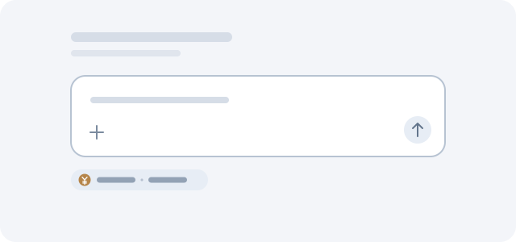

# Show me my money

Estimated spend for the current turn and for the whole session, in DeepSeek
Harness's composer dock.



DSH ships token counts but no money. This bundle turns those counts into money
using **your** price table, keeps the table fresh from DeepSeek's published
price page, and puts the answer where you are already looking — the thin
statistics row under the message composer.

## What you get

- **本轮 / Turn** — the newest turn's cost, summed over every billed model call
  in it. A long tool-using turn grows step by step.
- **累计 / Total** — the whole session's cost, from the complete durable log.
- **A panel** (click either reading) with a breakdown for *the most recent
  request*, *this turn*, and *the whole session*: model route, tokens per
  bucket (uncached input, cache read, cache write, output), subtotal, and the
  price band each figure was priced in.
- **Idle/peak pricing**, because DeepSeek charges double at peak.
- **A price table you can actually maintain**: a JSON file an editor, an agent,
  or the panel can write, refreshed automatically from DeepSeek's docs.

## Requirements

- DeepSeek Harness `0.2.2-rc.5` or a compatible build (`@deepseek-ai/dsh`).
  Built and tested against that version.
- The Web GUI or the Desktop shell. The reading lives in the composer dock,
  which is a browser slot.

No API key, no account, no service of its own.

## Install

1. Copy or clone this directory somewhere stable.
2. In DSH open **Plugins** → **Add plugin** → choose the local directory.
3. The bundle installs, activates, and inserts one row named
   `show-me-my-money`. Keep it enabled.
4. Refresh the page (a new client module is fetched).

**Plugins** → your plugin's row shows the title and description from
`locale/*.json`; the detail page shows `docs/DETAIL.zh.md`.

The package name is the plugin id. It ships as `@local/show-me-my-money`, the
conventional local scope; renaming it means updating `package.json`,
`cordis.patch.yml`, and the `id` in `client.js` together.

## Prices

### The file

```
~/.dsh/show-me-my-money.json          # $DSH_HOME/show-me-my-money.json when set
```

It is created with the shipped defaults on first activation:

```json
{
  "currency": "¥",
  "remote": {
    "enabled": true,
    "url": "https://api-docs.deepseek.com/zh-cn/quick_start/pricing.md",
    "intervalMinutes": 360,
    "lastSyncAt": "2026-11-22T08:55:22.000Z"
  },
  "peak": {
    "enabled": true,
    "timeZone": "Asia/Shanghai",
    "weekdays": [1, 2, 3, 4, 5],
    "windows": [{ "start": "09:00", "end": "12:00" }, { "start": "14:00", "end": "18:00" }]
  },
  "perMillion": { "input": 1, "cacheRead": 0.02, "cacheWrite": 1, "output": 4 },
  "models": {
    "deepseek-flash": {
      "idle": { "input": 1, "cacheRead": 0.02, "cacheWrite": 1, "output": 4 },
      "peak": { "input": 2, "cacheRead": 0.04, "cacheWrite": 2, "output": 8 }
    },
    "deepseek-v4-pro": {
      "idle": { "input": 4.5, "cacheRead": 0.15, "cacheWrite": 4.5, "output": 13.5 },
      "peak": { "input": 9, "cacheRead": 0.3, "cacheWrite": 9, "output": 27 }
    },
    "*": {
      "idle": { "input": 1, "cacheRead": 0.02, "cacheWrite": 1, "output": 4 },
      "peak": { "input": 2, "cacheRead": 0.04, "cacheWrite": 2, "output": 8 }
    }
  }
}
```

| Field | Meaning |
|---|---|
| `currency` | Symbol printed in front of every amount. |
| `remote` | Automatic pricing: `enabled`, the page to read, `intervalMinutes` (floor 15), and the `lastSyncAt` the Host wrote. |
| `peak` | The peak rule: `enabled`, an IANA `timeZone`, `weekdays` (0 = Sunday), and half-open `HH:MM` windows. `enabled: false` uses idle prices all day. |
| `perMillion` | Last-resort flat bucket prices, per 1,000,000 tokens. |
| `models` | Per-model prices. A model id matches exactly first, then by substring; `*` prices anything left. Each entry may carry `idle`, `peak`, or flat buckets (which apply to both bands). |

Every bucket is a price per 1,000,000 tokens: `input` is prompt text that missed
the cache, `cacheRead` is prompt text served from it, `cacheWrite` is prompt text
written into it, and `output` is completion tokens with reasoning included.
DeepSeek bills cache writes as normal input, which is why `cacheWrite` equals
`input` throughout.

A malformed member is reported in the panel and falls back to the default, so a
typo never blanks the reading. A file that is not valid JSON falls back wholesale
with the parse error shown.

### Automatic pricing

The Host re-reads DeepSeek's published price page every **six hours**, on
activation when the last sync is older than that, and whenever you press
**同步官方价 / Sync official prices** in the panel. It parses only the model
price table, so it survives layout changes elsewhere on the page.

A refresh writes `models`, `perMillion`, and `remote.lastSyncAt` — nothing else.
Your `currency` and your `peak` rule are preserved. A failed fetch or parse
leaves the file untouched and reports the reason in the panel.

Because auto pricing owns `models`, it replaces any model row you edited by hand.
Set `remote.enabled: false` to take the table back, or raise
`remote.intervalMinutes` to refresh less often.

### Editing from the panel

Click the reading → **改单价 / Edit prices**: pick a model, edit its idle and
peak columns, save. It writes the same file through the Host, so an agent
editing the file and you editing the panel stay in sync.

To keep prices inside a workspace instead, point the bundle at another file:

```yaml
- id: show-me-my-money
  name: '@local/show-me-my-money'
  config:
    file: ./prices/show-me-my-money.json   # resolved against the working directory
```

## How the numbers are computed

Session data reaches the page as **Host projections**; the browser only applies
prices.

| Projection | Owner | What the reading takes |
|---|---|---|
| `spendUsage` | this bundle | The newest billed attempt and every attempt of the newest turn, folded from committed `assistant/message` events over the whole durable log. |
| `tokenUsage` | `@deepseek-ai/dsh-token-meter` | Whole-session input, cache-read, cache-write and output tokens. |
| `modelSelection` | `@deepseek-ai/dsh-agent` | The model the next or latest call used, which selects the price row. |

`spendUsage` is registered on `ctx.sessionProjections`, so it is driven once per
committed event, checkpointed with the other units, and backfills by folding the
existing log if it registers mid-session. Paging, compaction and the loaded
history cut cannot move the figures.

### Price bands

DeepSeek charges double in peak hours: Beijing time, Monday to Friday,
09:00-12:00 and 14:00-18:00. Every other hour — including the whole weekend — is
idle. Each reading uses the band its own data supports:

- a request is priced by **its own timestamp**, so a request made at 08:58 is
  idle even when you look at it at 10:00;
- a turn sums its attempts, **each in the band it was made in**, and labels
  itself `idle + peak` when it crossed the boundary;
- the session total uses the band **in effect when you look**, because the
  durable token aggregate has no per-request timestamps.

## Host routes

| Route | Purpose |
|---|---|
| `GET /plugins/show-me-my-money/prices` | The effective config, the file path, warnings, and the last refresh outcome. |
| `POST /plugins/show-me-my-money/prices/save` | Replace the file with a validated config; answers the fresh payload. Refuses a cross-site `Origin`, bodies over 64 KiB, and any config that would produce a warning. |
| `POST /plugins/show-me-my-money/prices/sync` | Re-read the published page now; `502` with the reason when the fetch or parse fails, leaving the file untouched. |

The routes inherit the Host server's bind address; the shipped Web composition
binds loopback, so they are reachable only from this machine. The write routes
check `Origin` against `Host`; the browser's own POST always carries a matching
pair, a cross-site page cannot.

## Privacy

- One kind of outbound request: a `GET` of the pricing page at `remote.url` every
  `remote.intervalMinutes`. Set `remote.enabled: false` to stop it entirely.
- Everything else is local: three Session projections, one JSON file, and the
  routes above.
- No telemetry, no account, no analytics.

## Limits

- Every figure is an estimate from provider-reported tokens times your prices,
  not an invoice.
- Chinese public holidays are not modelled: they are idle all day, but this
  treats a weekday holiday as a normal weekday.
- Only token usage is priced. Search, Fetch, OCR and speech fees are on the
  price page but out of scope.
- The panel's editor and the two buttons need the page served over HTTP. A shell
  that loads the page from `file://` forwards `fetch` through a GET-only bridge,
  so there the editor reports a failure and the price file is the way to edit.
  Automatic pricing runs in the Host and keeps working either way.

## Development

Plain JavaScript, no build step, no dependencies. That is deliberate: the Host
half is loaded as-is and the Client half registers itself with
`window.__ModuleLoader__`.

| File | Role |
|---|---|
| `index.js` | Host half: the `spendUsage` projection, the price file, the refresh loop, and the three local routes. |
| `client.js` | Client half: the dock entry, the panel, pricing, and the editor. Registered into `conversation.composer.dock` with id `spend`. |
| `cordis.patch.yml` | Inserts the plugin row. |
| `locale/*.json` | Plugin title, description, detail document path. |
| `docs/` | The detail page image and its two documents. |
| `icon.svg` | The plugin icon. |

Useful checks while editing:

```powershell
node --check index.js
node --check client.js
```

The installed plugin is the preview: refresh the page after changing
`client.js`; reload the plugin row after changing `index.js`.

Repository conventions — documentation rules, runtime boundaries, the definition
of done, and how to verify each layer — live in [AGENTS.md](AGENTS.md).

## License

[MIT](LICENSE)
